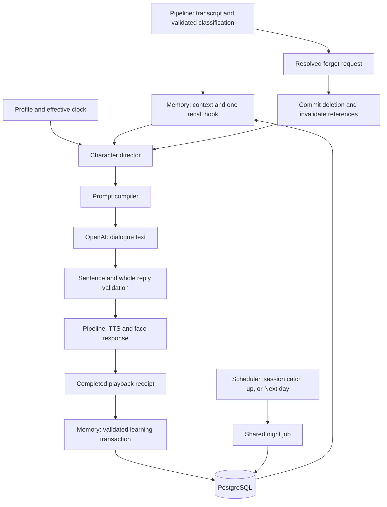

# Miu Character Engine Memory and Time Technical Proposal

Status: Proposed implementation

Date: October 31, 2026

Scope: `backend/character/` and `backend/memory/`
External AI provider: OpenAI

Build the character engine as a deterministic policy module and memory/time as a transactional PostgreSQL module inside the existing backend. OpenAI interprets input, writes dialogue within an approved plan, and assists with safety validation. Application code owns character state, memory writes, forgetting, time, and daily rollover.

The first complete demonstration is **Mochi puddle → completed playback → stored event → Next day → “Did Mochi get a bath?” → “forget that.”** The bath remains a question inferred from the reported event. It never becomes a fact unless the child later reports it.

This proposal adds implementation decisions to the existing [character specification](character-engine.md), [memory and time specification](memory-and-time.md), [pipeline specification](pipeline.md), and [API contracts](api-contracts.md). Those documents remain the behavioral requirements. The proposed runtime is TypeScript in one backend process; confirm that runtime with the pipeline owner before creating the shared implementation.

## Architecture and ownership



| Area | This workstream delivers | Integration boundary |
| --- | --- | --- |
| Character | Versioned canon, all 16 style presets, 13 director rules, prompt compiler, speech validators, presentation plan | Pipeline supplies observations and invokes generation/safety adapters; frontend renders the returned plan |
| Memory | PostgreSQL migrations, evidence validation, learning, one-hook recall, correction, forgetting, promises and checkpoints | Pipeline supplies authenticated profile scope and playback lifecycle |
| Time and daily life | Injectable clock, daily mood, authored diary, follow-up rules, friendship review, idempotent rollover | Pipeline mounts the existing demo routes and invokes session-open catch-up |
| Shared contracts | Typed inputs, version guards, errors, fixture expectations | Agree with pipeline owner before connecting modules |
| Outside this ownership | Microphone, STT/TTS implementation, browser animation, session transport and authentication | Coordinate requirements without duplicating these components |

Use the OpenAI SDK for provider access, Zod for runtime contracts, and a PostgreSQL driver with parameterized SQL and explicit transactions. Keep migrations in the memory module. Use the backend's chosen test runner and a real disposable PostgreSQL database for integration checks. No additional AI framework, queue service, or vector database is required for the MVP.

### Proposed source layout

```text
backend/
  shared/contracts.ts                  # Pipeline and module boundary types
  character/
    index.ts                          # Public module exports
    profile.ts                        # Canon, age/language/role policies
    presets.ts                        # Explicit mappings for all 16 MBTI types
    director.ts                       # Pure policy decisions and D01–D13 traces
    prompt.ts                         # Trusted instructions and untrusted context
    validation.ts                     # Sentence, plan, and combined-reply checks
    templates.ts                      # Approved English/Vietnamese fallbacks
    fixtures/                         # Plans and expected bilingual behavior
  memory/
    index.ts
    migrations/                       # Ordered SQL migrations
    repository.ts                     # Scoped queries and transaction helpers
    evidence.ts                       # Supported capture rules and projections
    learning.ts                       # Playback-gated writes and retries
    recall.ts                         # Selection and reservations
    forgetting.ts                     # Resolution, dependency deletion, correction
    clock.ts                          # Wall time and effective time
    night-job.ts                      # Shared atomic daily rollover
    authored-life.ts                   # Diary, mood, and follow-up rule library
    panel.ts                          # Bounded read model
```

Provider adapters stay in `backend/pipeline/`. Character and memory accept typed dependencies rather than creating their own OpenAI clients or HTTP endpoints.

## Character engine design

### Separate stable identity from changing state

`MiuProfile` contains versioned identity, approved self-facts, speech policies, role overlays, voice compatibility, and allowed expressions. Load it as authored configuration. A parent preset change replaces style parameters while preserving canon and memories.

Store personality, role, language mode, and voice in configuration. Store the current daily mood in PostgreSQL. Keep the current turn emotion, comfort overlay, and activity in transient session state. Compute rhythm from the effective local time. These values have separate owners and lifetimes.

Use five normalized style dimensions: energy, directness, imaginative detail, structure, and movement. Start with these authored mappings, then tune against bilingual examples:

| Preset axis | Initial contribution |
| --- | --- |
| E / I | Energy and movement `0.7 / 0.4` |
| N / S | Imaginative detail `0.7 / 0.3` |
| T / F | Directness `0.7 / 0.4` |
| J / P | Structure `0.7 / 0.3` |

Materialize an explicit record for each of the 16 codes listed in the [character specification](character-engine.md), with a short authored style description. These are creative controls. Empathy, honesty, response limits, and safety do not vary by axis. Apply role wording after preset selection; apply comfort and safety constraints last.

### Director decisions

Implement `decide()` as a pure function of a consistent context snapshot. It returns the existing `DirectorPlan`, plus internal plan/schema versions and source dependency IDs. The model never fills this plan.

Apply the specification's rules in this precedence:

1. **D01:** stop, cancellation, and safety routing.
2. **D02 and D09:** the child's expressed needs and comfort suppression.
3. Current supported activity, pending clarification, or resolved memory operation.
4. **D03–D07 and D10–D13:** identity, bounded style, language, speech limits, turn emotion, grounded recall, supported promises, fictional life, and permitted familiarity.
5. **D08:** daily mood and rhythm, followed by permitted stylistic variation.

Keep rule IDs stable even when evaluation order differs from numeric order. Output terse traces such as `D02:comfort` and `D10:hook_suppressed`, without dialogue text.

Choose one purpose per reply: comfort, clarify, answer, play, follow-up, resume, farewell, or acknowledge a committed memory operation. Current needs can suppress an otherwise eligible memory. A bedtime ENFP Miu comforting a sad child must use calm text, calm delivery, no giggle, no purr, and no startling gesture.

Comfort persists across ambiguous acknowledgments such as “okay.” Clear it only on an explicit correction or a welcomed change of activity. Do not persist emotional hypotheses about the child.

Promises require an existing app capability and a saved resumable checkpoint. The director may authorize an offer; it becomes a heard commitment only after completed playback. Fulfillment requires the actual supported activity transition.

### Prompt compiler

Compile trusted instructions from canon, selected style, language/age policy, purpose, speech limits, delivery constraints, and allowed commitment types. Send names, memories, current words, and recent dialogue in a separately labeled data payload. Mark all child-derived content as untrusted; never insert it into instruction templates as executable policy.

The payload contains only the selected hook, minimal supporting facts, approved fictional context when appropriate, and bounded recent session dialogue. Respect the pipeline's maximum of 12 completed exchanges and a separate prompt token budget. Never include deleted content, full database rows, another profile, credentials, or generated-but-unheard promises.

For the Mochi opener, supply both the reported puddle fact and the authorized bath question. Prohibit a bath assertion. The dialogue output is plain speakable text with 1–3 short sentences and at most one question. Presentation comes from the immutable director plan.

### Validation before synthesis

Run local sentence splitting and checks on every sentence, then check the combined reply in context. Local gates enforce length, names, allowed labels, forbidden stage directions, comfort restrictions, and supported commitments. They also verify that referenced canon/diary IDs and source dependencies still exist.

For free-form real generation, combine these gates with OpenAI content moderation and a separate contextual verdict covering child appropriateness, grounded claims, AI honesty, exclusivity, secrecy, and unsupported promises. A valid JSON verdict does not prove the assessment is correct; evaluate it with adversarial bilingual cases. Moderation categories alone do not cover character consistency or factual grounding. [OpenAI moderation](https://developers.openai.com/api/docs/guides/moderation).

Any blocking result prevents TTS for the entire reply. Allow one constrained rewrite only when the total deadline permits; validate the replacement again. Otherwise use an approved localized fallback matched to the purpose. If required checks fail or time out, use that fallback or a contract error. A technical failure must never sound like a successful deletion or completed promise.

## Memory design

### Three kinds of context

| Context | Location | Lifetime and use |
| --- | --- | --- |
| Recent dialogue and pending clarification | Pipeline session memory | Current session, at most 30 minutes idle; supports pronouns and immediate reference resolution |
| Selected personal memories and supported activities | PostgreSQL | 30 real days from creation or explicit reconfirmation; minimal grounded records |
| Miu canon and authored fictional life | Versioned configuration plus current daily records | Canon is authored; personal diary/checkpoint references follow retention and deletion rules |

Use structured SQL retrieval first: due date, entity, event type, topic category, status, and recency are sufficient for the demo. Defer semantic retrieval. If broader recall later needs it, OpenAI embeddings can rank already eligible records in PostgreSQL; they must share source dependencies, expiry, and deletion behavior. Embeddings measure relatedness and do not establish evidence. [OpenAI embeddings](https://developers.openai.com/api/docs/guides/embeddings).

### Schema and invariants

Implement the tables defined in the [memory specification](memory-and-time.md), grouped into these migrations:

| Migration | Tables and key responsibility |
| --- | --- |
| Profile and configuration | `profiles`, `miu_configs`, `demo_clocks`; versions, timezone, deletion epoch |
| Grounded memory | `entities`, `entity_aliases`, `facts`, `events`; minimal typed evidence and source handles |
| Follow-through | `promises`, `story_checkpoints`, `miu_self_statements`, `followups`; supported commitments and grounded questions |
| Dependencies and learning | `memory_dependencies`, `turn_learning`; deletion closure and idempotent writes |
| Daily state | `daily_states`, `diary_entries`, `relationship_states`, `night_job_runs`; authored state and rollover receipts |

Every personal row carries `profile_id`. Use composite foreign keys or equivalent constraints to prevent cross-profile relationships. Add a small profile-scoped registry of deletable record IDs if needed to enforce valid endpoints for the heterogeneous `memory_dependencies` graph; avoid unchecked polymorphic IDs.

Each learnable record includes a source turn/candidate handle, evidence kind, confirmation state, minimal value, scope, real creation/reconfirmation/expiry timestamps, and narrative date/precision where relevant. Evidence kinds distinguish `child_reported`, `reported_plan`, `inferred_question`, and `approved_fiction`. Store a filtered projection of evidence, never a full transcript.

Required database constraints:

- Unique learning receipt per `(profile_id, turn_id)` and derived candidate per `(profile_id, source_turn_id, candidate_key)`.
- Unique follow-up per `(profile_id, source_id, rule_id)`; unique diary and completed job per `(profile_id, local_date)`.
- One current daily-state row per profile; preserve the job receipt when replacing the old mood, without retaining mood history.
- Indexed `(profile_id, status, due_local_date)` follow-up lookup and `(profile_id, expires_at)` expiry lookup.
- Bounded enumerations and parameterized queries; every repository operation requires server-resolved profile scope.

### Learn from a completed turn

The classifier proposes candidates with exact evidence spans and uncertainty. `evidence.ts` accepts only supported English/Vietnamese capture patterns and directly stated low-risk details. A valid schema or high classifier confidence cannot authorize a write by itself. Ask one clarification for ambiguous names or conflicting identity; suppress sensitive content and “don't remember this.”

On a valid completed-playback receipt, the pipeline atomically accepts completion and inserts a `turn_learning` job containing a filtered projection and the captured deletion epoch. In the MVP, durable acceptance is this database insert; in-memory receipt state is updated only after commit. Losing a process before that commit must not produce a successful learning acknowledgment.

The learner then takes a short profile-row lock and:

1. Verifies profile, source date, supported candidates, playback eligibility, expiry, and deletion epoch.
2. Deduplicates candidates and resolves existing entities conservatively.
3. Writes entities, facts/events, approved heard self-statements, supported promises/checkpoints, and dependency edges in one transaction.
4. Marks the job complete and removes its projection content, retaining only short-lived content-free receipt metadata.

Use a small in-process worker that also drains eligible durable jobs at startup. Retry transient failures with bounded backoff. Purge unrecoverable projection content within the session inactivity window and show failure in the panel. The normal next turn briefly waits for accepted learning to finish or returns `learning_pending`; Next day always refuses while it remains pending.

Conservatively discard interrupted turns for MVP learning. Started playback marks a hook presented; only completed playback establishes heard promises, self-statements, and shared activity milestones.

### Recall and reservation

`reserveRecall()` returns zero or one hook after filtering by profile, active source dependencies, confirmation, real expiry, narrative eligibility, and deletion epoch. For a neutral greeting, rank due follow-ups, supported open promises, relevant facts, then approved shared moments. For ordinary turns, current topic and wellbeing win.

Reserve a follow-up under the profile lock with a turn ID and a short lease measured in real time. An atomic status check prevents duplicate selection. Release on generation failure or cancellation before playback; expire abandoned reservations. A valid started receipt marks the hook presented. Retain its terminal receipt until the source expires so rollover cannot recreate it.

The director can suppress a reservation, including during comfort, without marking it heard. Release suppressed hooks. A diary opener occupies the same single proactive-reference slot.

### Forgetting and correction

Resolve “forget that” from server-owned session references: the most recently heard referenced memory first, otherwise the most recent learnable child statement. If resolution is ambiguous, clarify and delete nothing. Full-profile forgetting uses the specification's one simple confirmation. Model output never supplies deletion authority or arbitrary IDs.

Under the same profile-row lock used by learners and rollover:

1. Resolve and revalidate the target, increment deletion epoch/state version, and delete its dependency closure.
2. Cancel and clear stale pending projections and dependent prepared work. Discarding an entire older projection is acceptable.
3. Commit; then synchronously scrub affected session text, reference handles, replay/idempotency payloads, and panel caches before preparing an acknowledgment.
4. Rebase the forgetting turn onto the new versions. Other work with the old epoch is discarded.

If the database write fails, no success acknowledgment is allowed. If playback is later canceled, the committed deletion still stands. After a process crash, transient caches disappear and PostgreSQL remains authoritative.

For Mochi, keep separate pet and puddle-event records. The dependency direction is pet → event → follow-up. Deleting the event removes its hook while preserving the pet; deleting the pet removes the whole chain. Sharing a source turn does not make the two records the same deletion target.

Corrections preserve a confirmed entity's stable ID, retire invalid aliases, update dependent display values, and invalidate prepared speech. Never merge similar names automatically.

### Retention

Expiry always uses real server time. Retrieval does not renew it. Filter expired records on every read and run a periodic dependency-aware cleanup to physically remove them, independent of nightly narrative rollover. Diary entries, promises, relationship permissions, and checkpoints also expire within 30 real days. Derived records cannot outlive their supporting personal data.

Keep session text only in session memory. Keep operational diagnostics content-free for seven real days, without names, transcripts, or stable child identifiers. Do not create content-bearing logs or persistent content backups in this prototype. The panel exposes bounded projections rather than prompts or raw candidates.

## Clock and daily rollover

Expose `wallNow()` for privacy expiry, reservation leases, and real timestamps; use a monotonic clock for latency and deadlines. Expose `effectiveNow(profile)` and `localDate(profile)` for event dates, mood, diary, follow-ups, and rhythm. Store the profile timezone explicitly, defaulting to `Asia/Ho_Chi_Minh` in demo fixtures.

In real mode, effective time follows wall time. In demo mode it advances from a stored effective anchor using elapsed wall time; panel actions move that anchor forward. Add calendar dates in the configured timezone. Next day targets **09:00 on the next local date**, rather than adding 24 hours. Clock changes never extend privacy retention.

Implement one `runNightJob()` path used by Next day, scheduler requests, and session-open catch-up. Its transaction locks the profile, checks for active turns/pending learning and completed receipts, removes expired sources, derives supported hooks, selects one authored diary and daily mood, reviews friendship, and records completion. Next day also updates the clock and closes the old session in that transaction. Failure rolls back both the clock change and the daily state.

Use a stable authored selection seed for profile/date/template version so retries choose the same diary/mood. Keep fictional events independent of child data where possible. A diary involving a known toy needs an explicit dependency edge. Rollover makes no OpenAI request and never starts speech.

Relationship stages require actual completed shared activities and welcomed familiarity. A new day or repeated visit does not advance friendship. Expiry/deletion removes unsupported nickname, joke, and milestone references while keeping Miu warm.

If several dates were skipped, initialize only the current date. Repeated request IDs return the same completed result; a different request with a stale expected clock version returns `409 stale_clock`. For scheduler/catch-up calls, unique date completion prevents duplicates. A new explicitly opened session requests its greeting through the existing turn endpoint.

## Internal integration contracts

Use shared Zod schemas and inferred TypeScript types. The following signatures describe module boundaries; the full field definitions follow the existing specifications.

```ts
type Guard = {
  profileId: string; // Resolved by the server, never trusted from model output.
  sessionId: string;
  turnId: string;
  stateVersion: number;
  clockVersion: number;
  deletionEpoch: number;
};

interface CharacterEngine {
  decide(input: DirectorInput): DirectorPlan;
  buildPrompt(plan: DirectorPlan, context: PromptContext): ReplyRequest;
  validateLocal(text: string, plan: DirectorPlan): LocalValidation;
}

interface MemoryService {
  getContext(guard: Guard, topic: Topic): Promise<MemoryContext>;
  reserveRecall(guard: Guard, purpose: Purpose): Promise<RecallHook | null>;
  releaseRecall(guard: Guard): Promise<void>;
  recordPlayback(guard: Guard, receipt: PlaybackReceipt): Promise<PlaybackResult>;
  applyLearning(scope: ProfileScope, jobId: string): Promise<LearningResult>;
  forget(guard: Guard, target: ResolvedForgetTarget): Promise<ForgetResult>;
  correct(guard: Guard, correction: ConfirmedCorrection): Promise<CorrectionResult>;
  runNightJob(input: NightJobInput): Promise<NightJobResult>;
  getPanel(scope: ProfileScope): Promise<DemoPanel>;
}
```

`MemoryContext` is a bounded snapshot of the current daily state, permitted familiarity, supported activity state, and eligible references. `RecallHook` contains evidence kind, minimal facts, an allowed claim/question, source IDs, expiry, and deletion epoch. `ForgetResult` returns committed versions and invalidated handles. None of these internal objects grant the client permission to query arbitrary records.

For the initial single-process deployment, a per-profile operation coordinator serializes turn registration, configuration changes, learning, deletion, and rollover. PostgreSQL profile-row locks protect every persistent mutation. Do not hold a database transaction or row lock while calling OpenAI. Capture a consistent snapshot, release the transaction, then recheck cancellation and all versions before publication or writes. Multiple backend processes would require a shared active-operation lease before deployment.

Keep the existing public routes and response envelope. The pipeline maps `DirectorPlan` to `presentation` and `face`, records playback receipts, and mounts panel/clock routes. One small proposed contract addition is an optional `memory.invalidate_replay: true` flag after a committed deletion/correction. The frontend clears captions, repeat audio, and cached memory cards before displaying the acknowledgment. Include the invalidation marker and current versions even if later generation/TTS fails; alternatively the pipeline must provide an equivalent invalidation mechanism before integration is considered complete.

## OpenAI integration

### API usage

Use the Responses API for classification, dialogue, and contextual validation. Start real-mode evaluation with `gpt-6-astra` as the configurable baseline. It supports low reasoning effort; use bounded output and evaluate latency rather than assuming the model meets the voice budget. OpenAI recommends current flagship models for experiences serving minors. [GPT-6 Astra](https://developers.openai.com/api/docs/models/gpt-6-astra), [under-18 guidance](https://developers.openai.com/api/docs/guides/safety-checks/under-18-api-guidance).

| Operation | Output | Application enforcement |
| --- | --- | --- |
| Classify current input | Strict schema for intent, language, explicitly stated feeling, uncertainty, safety route, and candidate evidence spans | Validate enums/spans, then apply supported capture and routing rules |
| Generate reply | Plain text only, no tools | Director-owned facts, purpose, language, speech limits, and commitments |
| Contextual safety verdict | Strict schema containing approval and bounded violation codes | Combine with local gates and moderation; fail closed on missing/invalid verdict |
| Content moderation | `omni-moderation-latest` through the moderation endpoint | Apply child-appropriate application policy to input and candidate output |

For structured calls, use Responses `text.format` with a strict JSON Schema, or the SDK's Zod helper. Require all keys, use nullable fields for absence, and reject additional properties. Handle refusal and incomplete responses explicitly. Schema adherence does not guarantee truthful evidence or safe semantics. [Structured Outputs](https://developers.openai.com/api/docs/guides/structured-outputs?api-mode=responses).

Set `store: false` on every Responses request and pass bounded context explicitly. Do not use provider Conversations, `previous_response_id`, hosted file search, or provider vector stores as Miu's durable memory. This keeps application correction, expiry, and deletion under one authority. Response storage and provider abuse-monitoring retention are separate controls; `store: false` does not establish zero retention. [Conversation state](https://developers.openai.com/api/docs/guides/conversation-state), [data controls](https://developers.openai.com/api/docs/guides/your-data).

Use server-side credentials, shared request deadlines, cancellation signals, and bounded retries. Disable implicit SDK retries that would exceed the turn deadline. Do not expose database tools to the model. STT/TTS remain pipeline-owned; their OpenAI model/voice choices need separate Vietnamese/English evaluation against the same playback and privacy requirements.

### Configuration and provider behavior

```dotenv
MIU_PROVIDER=fake
DEMO_MODE=true
DATABASE_URL=<local PostgreSQL connection>
MIU_TIMEZONE=Asia/Ho_Chi_Minh

# Required only for real mode; all values remain server-side.
OPENAI_API_KEY=<secret>
OPENAI_CLASSIFY_MODEL=gpt-6-astra
OPENAI_REPLY_MODEL=gpt-6-astra
OPENAI_CHECK_MODEL=gpt-6-astra
OPENAI_MODERATION_MODEL=omni-moderation-latest
```

These are proposed variable names, not an existing runnable configuration. Fake mode makes no outbound AI calls, requires no key, and uses declared transcripts and exact bundled speech clips supplied by the pipeline. It still runs real director logic, PostgreSQL learning/deletion, and rollover. Real mode fails startup on missing configuration and never silently switches providers.

The supervised demo uses fictional profiles and adult testers. Before processing real children's personal data, establish the provider controls required by OpenAI's under-18 guidance, including zero data retention for children under 13 or the applicable digital-consent age. ZDR requires provider approval; it is not enabled by a code flag. Review the selected speech endpoints and any caching behavior as part of that configuration. [Under-18 guidance](https://developers.openai.com/api/docs/guides/safety-checks/under-18-api-guidance), [data controls](https://developers.openai.com/api/docs/guides/your-data).

### Latency and cost

Retain the pipeline's **five-second p95 recording-end-to-audio-start target**. Within it, aim for context/director/prompt work below 150 ms and classification below 350 ms. Generation and complete output checking must fit alongside STT, TTS, and transport. Three sequential Responses calls plus remote moderation are a material risk to the proposed stage budget; benchmark the full real path before treating these allocations as achievable.

Run independent local and remote checks concurrently where dependencies permit. Keep learning and rollover outside the speech path, except mandatory deletion/correction and version checks. A fallback that does not answer the request is degraded service and cannot count as a successful latency pass.

Record per-call token usage and monotonic stage durations without content. Estimate a turn's text cost as `sum(input_tokens × input_rate + output_tokens × output_rate) / 1,000,000`, adding actual speech charges separately. Use billed output, including reasoning where applicable, and the selected models' published rates. Cap context, output, retry count, and real-mode demo spend. Daily rollover and ordinary SQL retrieval incur no OpenAI calls. [OpenAI pricing](https://developers.openai.com/api/docs/pricing).

## Implementation sequence

Deliver in this order so the pipeline owner can integrate a working slice early. Effort ranges are initial estimates for one engineer and exclude frontend/STT/TTS work and provider access lead time.

| Step | Deliverable | Estimated effort | Reviewable exit condition |
| --- | --- | --- | --- |
| 1 | Shared types, canon, all presets, clock abstraction, database migrations | 3–4 hours | Two isolated fictional profiles load; preset and version schemas agree with pipeline |
| 2 | Director, prompt compiler, local validators, bilingual approved templates | 4–5 hours | D01–D13 cases pass; comfort and bedtime produce a coherent face/voice plan |
| 3 | Completed-playback learning, SQL recall, deletion and correction | 5–7 hours | Mochi persists once; immediate forgetting and a stale learner cannot restore it |
| 4 | Atomic rollover, authored diary/mood, promises/checkpoints, friendship review | 4–6 hours | Next day and catch-up are idempotent; one eligible grounded opener is returned |
| 5 | Real OpenAI adapters with pipeline owner, panel projection, integrated rehearsal | 4–6 hours | Fake path works without keys; real bilingual checks and measured latency are reported |
| Total | Character and memory/time modules | 20–28 hours | Agreed acceptance cases demonstrated end to end |

If time tightens, reduce authored diary/story variety and extraction patterns. Preserve all 16 presets as parameter records, the shared contracts, playback semantics, forgetting, profile isolation, and validation. Defer embeddings, acoustic emotion inference, broad autobiographical summaries, and additional activities.

## Verification and delivery

Use unit tests for director precedence and validators, and PostgreSQL integration tests for persistence, concurrency, and rollback. Run provider-backed evaluation only with fictional inputs. Required cases are:

| Case | Required result |
| --- | --- |
| All 16 presets and role/language changes | Distinct style parameters; same canon, empathy, memories, and speech limits |
| Sadness plus lively mood or bedtime | No laughter, purr, teasing, or startle in text, delivery, or face |
| Uncertain names and injected instructions in names/memories | One clarification or safe fallback; no guessed fact or policy override |
| Safe first sentence plus unsafe second sentence | Entire candidate blocked before any synthesis |
| Unheard/interrupted reply | No heard promise, self-statement, or shared milestone learned |
| Duplicate completed receipts and learning retries | One accepted projection and one set of derived records |
| Mochi puddle and Next day | Reported event plus inferred bath question; no asserted bath or plan |
| “Forget that” after bath question | Event and hook removed; pet retained; no later hook recreation |
| Deletion racing with learning/generation | Old epoch cannot reinsert content or publish stale speech |
| Repeated/concurrent Next day and failed transaction | One date advance, one diary/mood/job; failure leaves clock unchanged |
| Expiry, skipped dates, and profile switch | Wall-time retention holds; no guilt/backlog or cross-profile references |
| Provider outage, refusal, or incomplete JSON | Bounded safe fallback/error; no unchecked output or false success |

Handoff includes migrations and fixture seeds, module exports and shared schemas, bilingual templates, fake-fixture expectations, deletion/invalidation behavior, panel projection, and a short integration guide. Rehearse Mochi, comfort, a supported story promise, and forgetting in both languages. Record fake and real latency separately over the specification's 30 short turns per language per provider; report cold starts, autoplay failures, degraded fallbacks, and any missing real-provider coverage.
