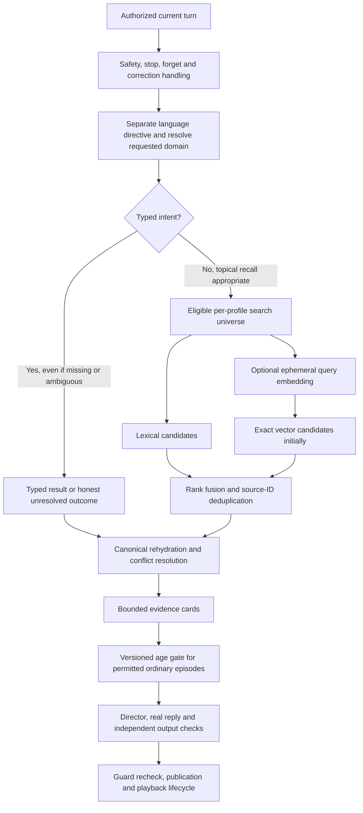

# Vector memory retrieval: architecture and integration plan

**Status: design only; implementation deferred at the user's request.**

Reviewed on 2026-10-31 against the current character/memory code and official provider/database documentation. No embedding request, vector extension, dependency, index, migration, backfill, feature flag, or production change is authorized by this document. A later implementation instruction is required before starting those changes.

This plan extends the [character and memory technical proposal](character-memory-technical-proposal.md), [memory/time specification](memory-and-time.md), and [product specification](product-specification.md). **The user has replaced the former 30-day memory policy: saved memories remain durable until explicit forgetting; age may influence recall, not physical deletion.** Other ownership, playback, correction, permission and deletion rules still apply. Current runtime expiry and historical tests have not yet been migrated to this policy.

For the authoritative storage-versus-recall distinction, see [Durable memory and age-based recall policy](memory-retention-and-recall-policy.md).

## 1. Decision and purpose

Use **hybrid retrieval in the existing PostgreSQL boundary** when benchmarks justify it:

1. Typed, exact retrieval for identity, permission, current preference slots, dates, corrections, and resumable checkpoints.
2. Lexical retrieval for literal topic/phrase matches.
3. Embedding similarity for paraphrased episodes and topics that the first two approaches miss.

Vectors return candidate **source record IDs**, never authoritative remembered prose. The application rehydrates current eligible records, resolves conflicts, and produces the same bounded evidence for the director, reply generator, and checker.

For example, a child may ask about “our cardboard spaceship picture” while the source says “tên lửa bìa … trong tranh.” Semantic retrieval could help discover that record. The selected source must still establish what was reported, when, and whether it remains usable.

Embeddings cannot repair a fact that was never captured, a wrong routing decision, a missing permission boundary, or a validator error. They do not authorize merging Bim with Bình, claiming a planned event happened, reviving an expired nickname, or reading another profile's history.

## 2. Current state and prerequisites

| Existing component | Current responsibility | Future integration boundary |
| --- | --- | --- |
| `backend/application.ts` | Profile/session authorization, turn lifecycle, operation ordering, version checks, completed playback | Request bounded retrieval; recheck guards before publishing or learning |
| `backend/recall.ts` | Typed memory queries and selected grounding | Keep typed precedence; consume eligible candidate IDs from a retrieval service |
| `backend/character/action-plan.ts` | Application-owned conversation/activity domain | Decide whether retrieval is appropriate and what slot/topic is requested |
| `backend/character/prompt.ts` | Bounded evidence shared with generation/checking | Accept rehydrated evidence cards, not a transcript or vector-store answer |
| `backend/pipeline/providers.ts` | Real provider access, input/output checking and diagnostics | Add a separate embedding adapter later; preserve dialogue/check model selection |
| `backend/memory/index.ts` | Canonical storage and lifecycle; currently includes legacy age-expiry | Migrate to durable memory while preserving hard permission validity and source revisions |
| `backend/memory/database.ts` | Native PostgreSQL or PGlite, current extension-free migration path | Add explicit optional vector capability without breaking non-vector startup |
| `backend/memory/import-history.ts` and migration `003` | Synthetic reference archive | Keep outside live recall and outside production embedding backfills |
| `backend/evaluation/` | Versioned scenarios, real model/API evidence, independent checks/reviews | Add retrieval-specific labels, ablations, race tests and latency/cost measurements |

The frozen corrected 100-case run produced **80 pass / 15 fail / 5 needs review**; this is not a vector-search baseline. See its [audit](../backend/evaluation/runs/real-100-fixes-2026-10-31T07-09/AUDIT.md). Subsequent correctness changes and catalog expansion need fresh evidence; existing scores must not be relabeled as results for new code.

Before implementing vectors, close the following relevant foundations:

- SC012/019: distinguish language directives, personal recall and public meaning questions.
- SC018: capture a bounded, heard reading activity rather than expecting retrieval to reconstruct an unsaved lesson.
- SC026: maintain comfort and active-game state independently of keyword mentions; repair bounded listening validation.
- SC036: deduplicate reconfirmed preferences and enforce the choice budget.
- SC043: supply eligible benign referent evidence to safety adjudication and reconcile safety/recall plans before generation.
- SC050: separate permission validity from retention and preserve unaffected current-turn activity after a correction.
- Correct evaluator false positives and operational evidence gaps before judging retrieval improvements.
- Replace automatic 30-day memory deletion and legacy expiry criteria with a versioned durable-memory policy before vector integration.

## 3. Three data universes must remain separate

| Universe | Permitted role | Vector policy |
| --- | --- | --- |
| Current session | Transient child/Miu conversation; discarded at closure or idle expiry | No durable transcript embeddings. Any query vector is ephemeral. |
| Canonical live memory | Selected low-risk, source-grounded durable records | Derived index follows source dependencies, explicit deletion/correction and hard permission validity; age does not delete it |
| Synthetic yearly reference archive | Fictional test inputs and authored reference answers | Evaluation-only namespace. Authored assistant answers, mood annotations and archive import are not heard evidence or live memory. |

**Saved memories have no automatic 30-day expiry under the new user decision.** Retain canonical memories and necessary derived index rows until explicit forgetting/deletion, or a correction retires a superseded active fact. Raw session/audio handling remains separate; this does not authorize storing full transcripts or sensitive disclosures.

For year-scale evaluation, replay the synthetic year through the real application and retain selected memories across that year. Reading or skipping a memory must not change its durable lifetime. Existing 30-day purge logic and tests such as SC054/055 are legacy behavior, not acceptance evidence for the new policy. Content already deleted under the old behavior cannot be reconstructed by embeddings.

## 3.1 Age-based recall without deletion

Separate storage, retrieval and reply availability:

- The canonical memory and its derived vector remain stored.
- Search must still find a relevant eligible source. A retrieval miss cannot be retroactively explained as random forgetting.
- A separate application-owned age policy may skip an ordinary old episode for this reply, leaving the stored source intact.

Proposed curve for ordinary episodes:

```text
age_days = max(0, profile_local_date - learned_or_child_reconfirmed_local_date)
effective_age = max(0, age_days - grace_days)
p_recall = floor + (1 - floor) * 2 ** (-effective_age / half_life_days)
p_forget = 1 - p_recall
available = stable_uniform_draw < p_recall
```

Illustrative parameters for later review, not implemented defaults: grace 7 days, half-life 90 days, floor 0.20. They yield p=1 through day 7, p=0.60 at day 97, p=0.40 at day 187 and p=0.25 at day 367. Personality, visit streaks, payment and the child’s absence do not change the curve. Miu must not blame the child for a skipped memory.

The proposed age clock uses the profile’s narrative local calendar so Next day can exercise it reproducibly; ratify this before implementation. Anchor age to learning or explicit child reconfirmation, **not the historical event’s occurrence date**. Keep actual creation/provider timestamps separately. Passive retrieval, Miu mentioning a fact and API retries do not reset age. A genuine child reminder may reopen the same source and record explicit reconfirmation after eligible completed playback.

In production, narrative time follows the configured profile-local wall calendar; demo-only Next day may advance it. Retain a monotonic age-date high-water mark across clock rollback and timezone changes so ordinary aging cannot reverse silently. A deliberate demo reset is a new isolated test state, not a way to rejuvenate live memories. Validate any timezone/clock-change migration before rollout.

Use a stable seeded draw for profile + canonical source ID + policy version + a defined day window. Do not seed from request ID, worker, vector generation or deletion epoch: retries, reindexing and unrelated deletions must not reroll surviving memories. Freeze the decision within its conversational window; repeated paraphrases must not cause flickering recall. Use the same draw across purposes; an explicit cue may raise probability instead of rerolling. Direct recall probability must be at least spontaneous recall probability so a remembered episode does not immediately become unavailable when asked about. Once recalled or recovered by a cue, retain the episode in active working context until conversation end; do not lower its availability on the next spontaneous turn. This session continuity does not itself reconfirm the durable source. Pin an active conversation’s window to avoid a midnight flip. The exact window and direct-query policy remain design decisions.

Proposed class boundaries, to ratify before implementation:

| Class | Age-dependent availability |
| --- | --- |
| Past reported events, past preferences/routines, child-authored story details and completed learning episodes | Eligible for the ordinary-memory curve; retain canonical sources regardless of availability |
| Current canonical identity, relationships and preference slots, corrections, deletion/no-save decisions, permission boundaries, safety rules and supported active commitments | Bypass randomness; these remain deterministic controls |
| Current task/checkpoint and facts just supplied by the child in the active conversation | Keep available for conversational continuity; a future historical episode may use the curve |

Typed routing alone does not exempt a historical date or episode from the age policy; the source's class and purpose determine eligibility. If direct ordinary historical questions use the age gate, specify a higher recall probability and cue/reminder path. The user preference between “both direct and spontaneous ordinary recall” and “spontaneous only” is pending.

On a skip, Miu can say it cannot bring that episode to mind right now and may ask for a reminder. It cannot claim “you never told me,” invent a replacement or announce database deletion. Gate the canonical memory group consistently across duplicate/derived cards, summaries and historical prompt context; do not leak its factual content to the reply model while asking it to act as though it forgot. Never hide facts the child supplies in the current turn: acknowledge that reminder, preserve current working context and reconfirm only after eligible completed playback. A reminder may resolve an existing valid source or provide a new explicitly stated fact; it cannot resurrect an explicitly forgotten source through a stale index.

Define one stable gate identity per canonical fact/episode, shared by every derived chunk or projection of that same memory. It is independent of embedding generation and document splitting. Distinct episodes that merely share an entity dependency remain separate gate units. A question containing a topic cue can raise availability without changing the age anchor; only an explicit, grounded child assertion/reminder may reconfirm it through existing completed-playback rules.

For example, “Do you remember butterfly?” is a query; “It was butterfly” can resolve a uniquely matched topic without confirming the whole past activity; “We practised reading butterfly” explicitly reconfirms that activity. Contradictory reminders go through correction/conflict handling rather than reinforcing an old source. Composite evidence cannot expose a skipped episodic dependency through a different summary, while independently supported protected identity/permission metadata remains available.

In isolated synthetic evaluations, record candidate IDs/ranks before the gate, age anchor, configured probability, policy/seed identity, draw and decision reason. Separate `retrieval_miss`, `policy_age_skip`, `hard_permission_denied` and `source_deleted`. Production diagnostics stay content-free and avoid stable child identifiers.

Runtime can observe `no_eligible_candidate`, eligibility failures and deliberate age skips. A true `retrieval_miss` requires offline ground-truth source labels; absence of a runtime candidate does not prove that no memory exists. Retrieval correctness is scored independently in the benchmark before evaluating age behavior.

Test fresh, 30-day, 365-day and multi-year ages. Source/vector membership must remain unchanged by age or skips. Measure retrieval before the gate, then conditional answer correctness and recall frequency by age/purpose with predeclared tolerance/confidence intervals. Count independent source/window draw units, not retries or paraphrases that share a draw, when reporting sample size and uncertainty; keep held-out seed groups fixed. Verify same-draw nesting across purposes and working-context continuity after recovery. Seeded mathematical tests are infrastructure checks; real embedding/dialogue tests must exercise both recall and skip paths without fake-provider substitution.

## 4. Retrieval contract and invariants

Every retrieval request is constructed by server code and carries an authenticated profile, optional server session ID, purpose, typed target/topic, allowed real/fictional scope, narrative date bounds when relevant, and captured state/deletion/clock versions.

Every selected item must carry:

- Canonical record ID and dependent source IDs.
- Record kind, evidence kind and real/fictional scope.
- Current source revision and projection hash.
- Durable creation/reconfirmation timestamps and narrower permission validity, if any; no mandatory age-expiry field for ordinary saved memories.
- Relevant narrative date/precision and plan conditions.
- Candidate method/rank and generation identity for diagnostics.

Non-negotiable invariants:

1. Resolve the profile from server authorization; never accept a model/client-selected arbitrary profile.
2. Require an active valid source and dependencies. Similarity cannot bypass deletion, retraction, correction, permission or confirmation. Old age alone is not invalidity.
3. Check day/session permission against the current narrative day and actual session. Ending permission is not erased history and cannot be undone by retrieving yesterday’s nickname. Ordinary saved memory has no TTL; technical leases and transient sessions use separate clocks.
4. Capture the profile deletion epoch to invalidate in-flight work. **Do not require every surviving source to have been created at the current epoch**; an unrelated deletion must not hide all older valid records.
5. Rehydrate and revalidate selected sources before prompt construction; recheck captured guards before publication and learning.
6. Explicit canonical corrections outrank old or semantically similar records. Similar names never establish identity.
7. Treat retrieved text as untrusted data, not instructions or permission for tools/actions.
8. Preserve the one-unsolicited-memory rule and the speech budget. Explicit recap requests can use more evidence within the approved budget.

## 5. Proposed read path



### Exact lane

Names, pet/object identity, relations, current favorite-color slot, address permission, diary date and catalog checkpoint use typed retrieval. A vector result cannot replace a known exact answer or supply an alternate identity. Branch on typed intent, not answer availability. A missing/ambiguous typed slot stays in that lane; vector top-k cannot shrink a canonical candidate set and manufacture certainty.

### Lexical baseline

Implement and measure a lexical baseline first. PostgreSQL full-text search supports indexed token/lexeme matching and relevance ranking. English and Vietnamese require separately tested normalization; do not assume English stemming is suitable for Vietnamese. Preserve NFC display text and personal-name accents. Any accent-insensitive discovery must still rehydrate the original exact identity. [PostgreSQL full-text search](https://www.postgresql.org/docs/current/textsearch-intro.html).

### Bilingual queries and task boundaries

Carry requested answer language, literal name/canonical-ID anchors and semantic topic separately. Remove language directives before discovery. Topic translation may aid matching, but cannot translate a name, rewrite literal evidence or establish identity. Test English/Vietnamese and code-switching in both retrieval directions.

Separate public definition, lesson follow-up and historical-episode purposes. A reading checkpoint establishes a practice topic, not dictionary meaning, decoding correctness or ability. Fiction/nonsense cannot establish public factual truth; a historical activity is not a current instruction to start it again.

### Semantic lane and ranking

Use embeddings only for an unresolved topical/episode query with an eligible corpus. Proposed initial budgets are 20 lexical candidates, 20 dense candidates, a deduplicated union capped at 30, and at most three rehydrated evidence cards. These are benchmark settings, not product guarantees.

Start with reciprocal-rank fusion rather than adding incomparable lexical and cosine scores. A candidate score is relevance, not factual confidence. Resolve recency, corrections, source status and temporal precision after candidate discovery, using application rules. Abstain or ask a focused clarification when no eligible source or an unresolved conflict remains. [pgvector hybrid search](https://github.com/pgvector/pgvector#hybrid-search).

Do not add an LLM reranker to the first version. Evaluate that separately only if rank fusion misses a measured target and its latency/provider handling fit the budget.

## 6. Corpus projection and chunking

The first corpus should contain minimal projections of eligible child-reported events, explicitly volunteered preferences, child-authored stories and supported learning activities. Keep conditions and temporal qualifiers. Do not persist inability, psychological inference, sensitive disclosures, addresses/contact information or full turns to make retrieval convenient.

Use one atomic source record per document initially. Retain its validated literal source value plus application-owned type/scope tags. Do not use a model-written autobiographical summary as evidence. Stable profile/session UUIDs do not belong in provider input text.

Separate or exclude these sources from the first semantic corpus:

- Nickname/permission rules, current identity slots and promises: typed lane.
- Authored Miu canon/diary/catalog scenes: separate application-controlled lookup.
- Inferred follow-up questions: never mixed into the child-reported fact pool.
- Unheard, canceled, interrupted, suppressed, deleted or retracted captures: ineligible. Historical text cannot renew ended permissions.
- Synthetic reference assistant messages and author annotations: ineligible live evidence.

Proposed application limit: 512 tokens per atomic projection. If a source exceeds it, keep lexical retrieval or design validated, source-linked subdivisions. Do not silently truncate away negation, conditions or scope. Any later multi-source summary must register every dependency and become unusable when any required source is deleted, retracted, corrected or no longer permitted.

## 7. Storage design to implement later

All new personal-data tables require composite profile-scoped foreign keys and parameterized access. Table names and shapes below are proposals, not existing migrations.

| Proposed object | Essential fields | Responsibility |
| --- | --- | --- |
| Canonical source revision | Monotonic content revision on an eligible source | Detect a changed source even if its registry ID survives |
| `memory_search_documents` | Profile/source ID, source revision, projection version/hash, scope, document text, lexical representation | Minimal rebuildable projection, bounded by canonical source eligibility |
| `memory_embeddings` | Profile/document FK, generation ID, source revision/hash, model, dimensions, vector, created time | One derived vector for one exact source version and model space |
| `embedding_jobs` | Source/document IDs, expected revision/hash, captured revocation guard, generation, state, lease, retry count/due time | Transactional outbox with no transcript/content payload |
| `search_generations` | Model, dimensions, projection/normalizer versions, distance convention, build/shadow/active/retired status | Controlled full reindex and atomic cutover |

Use unique keys covering profile, source/document, source revision and generation. Deleting a source must cascade to its documents, vectors and pending jobs. Any source-dependent document must participate in the existing deletion closure.

Store content hashes only inside protected application data. Operational logs should contain bounded counts, timings, model/generation IDs, request IDs when available and error codes—not query text, document text, personal names, full vectors or stable child identifiers.

## 8. Completed learning and asynchronous indexing

```mermaid
sequenceDiagram
    participant P as Playback/application
    participant DB as Canonical PostgreSQL
    participant W as Embedding worker
    participant API as Real embedding provider
    P->>DB: Commit eligible heard learning + source revision + outbox ID
    W->>DB: Claim leased ID; read and validate current source
    W->>API: Embed minimal projection outside transaction
    API-->>W: Vector and usage
    W->>DB: Recheck source/revision/hash/eligibility and guards
    W->>DB: Conditional idempotent vector write
```

- Never hold a database transaction, profile row lock or pooled connection while awaiting the provider.
- The queue stores IDs and version guards. Read content only after claiming a job; revalidate before dispatch and again before insertion.
- Reject wrong output count/order, wrong dimensions, non-finite/zero vectors and incompatible generations. Partial batch failure must not mark missing documents ready.
- Conditional vector insertion and ready marking require one short transaction locking/checking current source/dependency revisions, projection hash, revocation guard, generation and the current job lease token. A FK cannot detect changed content under a surviving ID; an expired lease worker cannot mark a newer attempt ready.
- An unrelated revocation may conservatively cancel a job; retry from a fresh eligible snapshot rather than accepting its stale guard.
- Lease expiry, exponential backoff, retry bounds and a content-free dead-letter status handle worker crashes/outages. Embedding failure leaves canonical learning valid and available through typed/lexical retrieval.
- An index-ready write changes derived search availability, not the character's identity, memory truth or friendship stage. Define a separate index generation/revision rather than unnecessarily advancing character state for every completed vector.

The current per-process application coordinator is not a distributed active-turn lease. Multi-instance serving requires a separate concurrency decision; adding background workers must not imply that current process-local coordination is sufficient for several serving instances.

## 9. Correction, forgetting and race handling

| Event | Required derived-data behavior |
| --- | --- |
| New completed eligible memory | Create/update projection and enqueue its exact version transactionally |
| Recall or age-based skip | No deletion, reconfirmation, new fact or re-embedding solely because a source was read/skipped |
| Correction/retraction | Retire dependent old projections/vectors, increment source/revocation guards and enqueue only the new eligible projection |
| Day/session permission end | End current authorized use immediately; preserve historical context separately. Never restore permission or quote the retired nickname unsolicited. |
| Memory becomes older | Adjust recall probability/salience only; keep its canonical source and vector. |
| Scoped forget | Commit canonical/dependent deletion and derived deletion; invalidate retrieval/session/replay caches before success |
| Forget all | Clear every profile-scoped source, projection, vector, job and cache; keep only permitted content-free operational metadata |
| In-flight embedding returns after deletion | Discard result. Conditional write/FK validation must prevent resurrection even when the provider request itself finished successfully. |

Provider requests already dispatched cannot be unsent. Cancel them where possible, but never claim that deleting local rows erases provider-side handling. The guarantee here is immediate local exclusion/deletion and no resurrection; external retention must be verified independently.

Do not create a second tombstone/content archive that retains the forgotten text. Any revocation marker must be content-free and scoped. Its lifetime must cover every worker, retired index and restorable backup that could resurrect the source; arbitrary short expiry is unsafe while older restores remain possible. Queue snapshots, caches, backups, exports and debug logs must be included in the data-lifecycle decision before real child data is introduced.

## 10. PostgreSQL and PGlite integration

Prefer pgvector in the existing PostgreSQL service over a separate vector database for the first version. It keeps source joins and derived deletion within one database boundary. Start with exact cosine ranking over an eligible profile-sized set; add ANN only after measured scale/latency warrants it.

With approximate indexes, a SQL filter does not imply a physical prefilter: pgvector documents that filtering can happen after ANN scanning, reducing returned eligible neighbors. A future ANN rollout must evaluate iterative scans, partition/index strategy and bounded same-profile exact fallback. Never fetch globally and rely only on application-side tenant filtering. [pgvector filtering](https://github.com/pgvector/pgvector#filtering).

The current `createDatabase()` does not load vector support. Current PGlite documentation distributes vector support through a separate extension package. Its compatibility with the repository's pinned PGlite version and native PostgreSQL must be tested in disposable environments; do not infer parity from documentation alone. [PGlite extensions](https://pglite.dev/extensions/#pgvector).

Do not place unconditional vector-extension DDL into the current always-run migration directory while non-vector PGlite startup remains supported. Plan an explicit optional migration/capability path, preserve feature-off startup, and choose migration numbers only when implementation begins. Extension installation and production database privileges are separate future operations.

## 11. Embedding provider and model decision

Use a separate provider adapter with configurable model/dimensions, deadline, retry policy and telemetry. Keep the existing dialogue model configuration unchanged. Benchmark these candidate configurations; neither is yet selected for deployment:

| Candidate | Proposed dimensions | Decision purpose |
| --- | ---: | --- |
| `text-embedding-3-small` | 1536 | Initial quality/latency/cost baseline |
| `text-embedding-3-large` | 1536 | Compare multilingual/semantic gain at the same stored dimensions |

Official defaults are 1536 for small and 3072 for large; the dimensions parameter supports shortening these models. Selection must follow the Miu English/Vietnamese benchmark, not model-name assumptions. [OpenAI embedding guide](https://developers.openai.com/api/docs/guides/embeddings).

The 1536-dimensional proposal also fits pgvector's documented HNSW `vector` index dimension limit. Do not assume a default 3072-dimensional large vector can use that index unchanged; alternative dimensions/types need a separate measured choice. [pgvector HNSW](https://github.com/pgvector/pgvector#hnsw).

Pin model, dimensions, distance and projection version into a generation identity. A query vector must use exactly the same model space as the searched generation. Never mix vector coordinates or raw distances across models/generations, and do not update an existing generation in place during a model migration.

Official API limits currently include non-empty inputs, a per-input token cap, at most 2048 input items and 300,000 aggregate tokens per request. Proposed application batches are much smaller: up to 32 bounded documents, split by token count and profile policy. Recheck limits at implementation time. [Embeddings API reference](https://developers.openai.com/api/reference/resources/embeddings/methods/create).

Query embeddings are ephemeral. Derive a minimal safe query topic after authorization and applicable sensitivity/safety checks; do not send an entire session or a raw sensitive disclosure merely to improve retrieval. Disable persistent query caching initially. Any later cache must be profile-scoped, revocation-aware, short-lived and invalidated with its sources.

The Embeddings API is not the Responses API: do not copy unsupported request fields such as `store:false` into it. `store:false` on dialogue calls is also not a provider zero-retention guarantee. Verify the account's actual data controls and eligibility before processing real child information. [OpenAI data controls](https://developers.openai.com/api/docs/guides/your-data).

## 12. Generation and safety integration

Produce an application-owned evidence envelope with source IDs, literal values, source/evidence kinds, dates/conditions, scope, hard permission validity, durable timestamps, revisions and captured guards. Use it consistently in the director, prompt and contextual checker. Do not give only the generator a useful relationship/event while leaving the checker to infer it from truncated dialogue.

Include an explicit application-owned disposition such as `available`, `permitted_age_skip`, `unresolved` or `hard_denied`. For a permitted skip, omit the hidden fact from generation and give the checker the bounded disposition and allowed uncertainty behavior. Neither the checker nor constrained repair may demand the hidden exact fact or turn temporary uncertainty into an `incorrect_recall` rejection. Revalidate canonical guards independently; the disposition is not permission to invent, weaken safety or conceal an actual retrieval failure.

Similarity never authorizes an action or a save operation. A retrieved plan remains a plan; a fictional character stays fictional; absence of an event report is not proof that it did not occur. Historical assistant claims remain non-authoritative unless separately approved by existing canon/heard-statement rules.

For SC043-like ambiguity, bounded eligible referent evidence may inform a separate contextual safety decision. Retrieval cannot turn a harmful request into an authorized one. Preserve raw moderation results and independent output checks. If the disposition and proposed exact response conflict, reconcile the plan before generation rather than repeatedly regenerating the same contradictory refusal.

## 13. Latency, capacity and failure budgets

The previous frozen text benchmark measured median preparation at 7.217 seconds and p95 at 10.230 seconds, without STT/TTS or audible playback. The product's five-second audible p95 target is not established by those results. Adding a query embedding to the critical path cannot be assumed affordable.

Initial design rules:

- Exact typed answers make no embedding request.
- Document embeddings run asynchronously after eligible completed learning.
- Measure a provisional p95 additional retrieval budget of 500 ms for semantic cache misses, then revise the architecture if the total voice budget cannot be met. This is a proposed gate, not a measured SLO or permission to relax the product target.
- Apply a deadline and use current typed/lexical evidence when vector retrieval is unavailable or late. Continue real dialogue generation; never substitute a fake provider for a quality evaluation.
- Keep bounded batch/concurrency/token budgets and a kill switch for embedding requests. Quota/authentication failures are recorded explicitly and stop repeated paid retries.

For capacity planning, 1000 vectors at 1536 float32 dimensions contain about 6.1 MB of raw coordinates before indexes, rows, metadata and parallel generations. Actual document count is the eligible projection count, not the number of historical transcript messages. Calculate provider spend from measured indexed/query/update/rebuild tokens and the then-current configured rate; do not hardcode a price estimate into acceptance.

## 14. Evaluation before implementation and release

Create a versioned benchmark specification before writing retrieval code. Its answer labels must identify eligible source IDs and supported claims; model judgments may assist review but cannot invent the ground truth.

Compare on identical scenario state and query sets:

1. Typed retrieval only.
2. Typed plus lexical retrieval.
3. Typed plus dense retrieval.
4. Typed plus lexical/dense fusion.

Use English, Vietnamese, mixed-language and cross-language paraphrases, exact names with accents, temporal queries, multiple similar episodes and legitimate no-answer queries. Split query/paraphrase families and episodes for calibration versus held-out scoring; the target sources must still exist in the evaluation corpus.

Required hard negatives include wrong profiles; similar names; pet/plush/story identity; corrected old values; denied/question/quoted/hypothetical statements; deleted/retracted sources and ended permissions; today/session nickname permission; conditional plans; unsupported/uncompleted promises; canceled/interrupted/no-save disclosures; malicious stored instructions; and a stale worker response after deletion/reindex/correction.

Proposed acceptance gates, to ratify before implementation:

| Dimension | Proposed gate |
| --- | --- |
| Policy invariants | Zero cross-profile, deleted, retracted, out-of-permission-scope or unsupported-source disclosures in the required suite |
| Exact typed slots | No regression in supported deterministic identity/permission/correction fixtures; ambiguity must not be guessed |
| Retrieval before age gate | For single-source targets, proposed hit@5 ≥95% overall and ≥90% per declared language/query family. For multi-source queries, report recall@k = relevant returned / relevant eligible, relevant-set cardinality and its achievable ceiling at k; set a separate cardinality-aware gate. Report precision among actually returned candidates. Fixed Precision@5≥80% is not an achievable gate for a one-source query. |
| Final evidence/no-answer queries | Define no-answer from eligible pre-age ground truth; an age-skipped answerable query is not a no-answer. Score variable-size final-card precision separately; empty returns have precision N/A. Ratify separate candidate false-positive-rate and final false-memory-claim gates before scoring held-out queries; proposed final false-memory claims are zero in required no-answer cases. |
| Age behavior | Storage/index membership survives age/skips; recall frequency follows the predeclared curve by age and purpose, while protected controls never become optional. |
| Added value | A predeclared meaningful gain on paraphrase queries over lexical baseline, without hiding lost precision or typed-slot regressions |
| Answer grounding | Every historical claim points to currently eligible supporting records; no pass inferred from cosine score or the engine's own checker |
| Lifecycle | Deletion/correction races, worker retries/crashes, expired leases, wrong generations/dimensions and outages produce no resurrection |
| Latency/cost | Measured real-provider overhead fits an agreed per-turn/monthly budget and the full voice target is separately demonstrated |
| Reproducibility | Corpus/query/label hashes; model/dimensions; projection/index versions; query plan/search parameters; source guards; candidate ranks; API provenance; latency and token usage |

Numerical targets above are design proposals, not current results. Fix them before looking at a held-out result. Report uncertainty across scenario/episode groups and do not tune against the held-out failures.

Use real embedding and dialogue providers for semantic and character/memory quality claims. Offline doubles are limited to clearly labeled schema, queue, filtering, mathematical ranking and lifecycle harness tests. If the provider fails, preserve attempted coverage and errors; do not replace it with a fake answer. Native PostgreSQL/vector behavior needs its own integration evidence even if PGlite tests pass.

A required real-provider regression must find an eligible known old source, exercise a reproducible permitted skip, produce honest temporary uncertainty, and pass the independent checker without repair leaking that hidden source. Pair it with the same source's available/reminder path, plus an explicit-deletion negative control. Report the genuine provider requests and all attempted outcomes separately from seeded policy arithmetic.

## 15. Future module/API shape

These are interface proposals only:

```text
MemoryRetrievalService.search(serverScope, request, capturedGuard)
  -> candidate source IDs, method/rank, source revisions and generation

MemoryStore.hydrateEligibleSources(serverScope, candidates, currentGuard)
  -> bounded typed evidence cards or stale/ambiguous/missing result

EmbeddingProvider.embed(minimalTexts, pinnedModel, dimensions, signal)
  -> ordered vectors, usage, provider request metadata when available

EmbeddingWorker.claim / dispatch / conditionalCommit / retry
  -> content-free operational outcome
```

The dialogue model cannot call arbitrary search SQL, install indexes, choose a profile, change retention, or write these tables. Public frontend routes should not expose vectors or arbitrary historical-search access. Preserve current response/receipt contracts; any future diagnostics are internal or explicitly synthetic evaluation data.

## 16. Phased implementation backlog

| Phase | Future work | Exit evidence |
| --- | --- | --- |
| 0 — Maturity | Complete relevant correctness fixes, replace legacy 30-day deletion and settle age/permission semantics, approve the benchmark and source contracts | Updated specification, real regressions, stable lifecycle and independent grader controls |
| 1 — Retrieval foundation | Central eligible-source API and typed/lexical baseline; no vectors | Source-ID precision, abstention, scope/deletion and query-plan evidence |
| 2 — Optional local vector capability | Disposable native PostgreSQL/PGlite compatibility, opt-in derived schema, adapter and outbox, exact vector search | Real embedding smoke tests plus deterministic race/schema/filter tests; feature-off startup preserved |
| 3 — Offline comparison | Build only the isolated synthetic/eligible benchmark corpus and run ablations | Versioned retrieval/answer metrics, costs, hard negatives and latency; no serving effect |
| 4 — Shadow | Compare vector candidates with the active baseline without changing replies | Stable eligible-source selection and operational budgets; no hidden data accumulation |
| 5 — Controlled serving | Explicitly authorized opt-in for approved data/environment | End-to-end real-provider regressions, deletion/replay tests, voice budget and a working rollback |
| 6 — Optimization | Consider ANN, reranking, caching or larger models only for measured bottlenecks | Improvement over exact baseline without weakening eligibility or recall |

No phase beyond this document begins automatically. Production credentials, extension installation, index backfill and deployment remain separate from this plan.

## 17. Rollback and operating rules

The first rollout must be reversible by disabling semantic search and continuing typed/lexical retrieval. Stop new embedding dispatches independently from serving. Canonical learning/deletion remains available when indexing is disabled; source deletion must still remove existing derived rows.

Keep old and new generations isolated during reindexing. Build a new generation from a fresh eligible source scan, reconcile changes that occurred during the build, validate coverage, and switch the active generation atomically. Remove retired index generations after a validated rollback window without deleting durable canonical memories or reviving forgotten content. A backfill must never read the reference archive as a shortcut.

Logs/metrics should show queue lag, ready/missing projections, deadline fallback, candidate eligibility drops, stale result rejection, retrieval quality samples from approved synthetic data, and token/request counts. They must not become another content archive. No comparison can promote a fake-provider result into real-model acceptance.

## 18. Decisions required before coding

1. Implement the confirmed durable-until-forget policy before vector integration. Migrate non-null `expires_at` rows and remove legacy 30-day purge behavior without restoring content already deleted.
2. Ratify projections, permission scopes, source revisions, protected memory classes, the age clock and the direct versus spontaneous recall rule.
3. Agree on English/Vietnamese benchmark labels, held-out splits and numerical gates.
4. Choose model/dimensions only after the benchmark design and cost/latency budget are accepted.
5. Verify compatible native/PGlite extension versions and optional migration strategy in disposable environments.
6. Verify provider/account handling for the actual data class; embedding vectors remain sensitive derivatives.
7. Assign serving/worker concurrency ownership, rollout environment and rollback responsibility.

Until those decisions and the maturity gates are satisfied, keep semantic retrieval unimplemented. Correctness work does not require embeddings, and this document records the revised durable-memory policy but does not implement it or authorize production changes.
