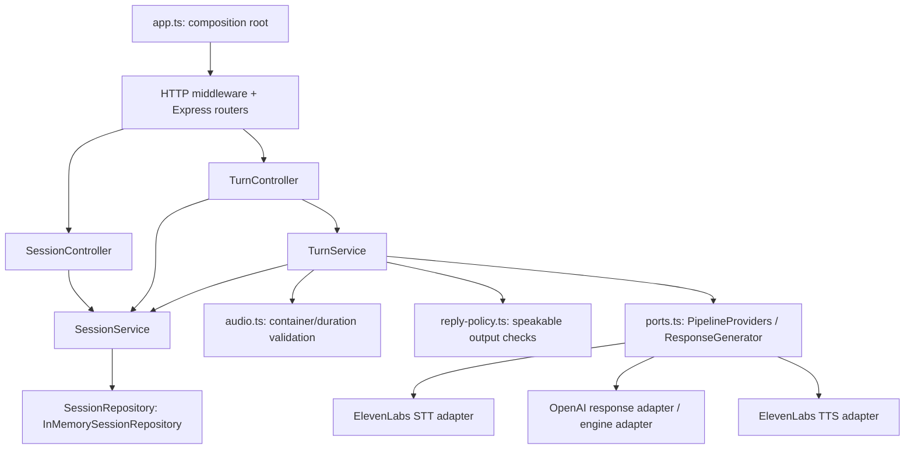

# Kiến trúc backend voice: Express 5 + TypeScript

Backend chạy trên Node.js, dùng Express 5 cho HTTP và TypeScript cho các module. `app.ts` lắp dependencies, middleware và router. Nghiệp vụ lượt nói nằm trong `TurnService`; controller chuyển request thành input của service và trả JSON theo [API contract](../api-contracts.md).

## Luồng phụ thuộc



Các service không nhận Express `Request`/`Response`. Chúng dùng input có kiểu, session hiện tại và `AbortSignal`. Các adapter trả transcript, reply text hoặc bytes audio; `TurnService` ghép chúng thành response chung.

## Cấu trúc code

```text
backend/pipeline/src/
  app.ts                          # composition root và dispose dependencies
  server.ts                       # entry point, đọc config, process signals
  server-runtime.ts               # Node HTTP server, listen/close và sockets
  config.ts                       # validate env, provider mode, voice/model defaults
  ports.ts                        # contracts nội bộ của STT/reply/TTS
  errors.ts                       # public error codes
  audio.ts                        # kiểm tra audio trong RAM, ffprobe có giới hạn
  multipart-limit.ts              # giới hạn bytes toàn multipart request
  http/
    middleware.ts                 # CORS, rate limit, no-store, JSON/body policy
    request.ts                    # bearer token, UUID, object parsing
    multipart.ts                  # Multer memory upload và map wire fields
    error-handler.ts              # lỗi JSON an toàn, ngôn ngữ và turn context
  modules/
    sessions/
      session.routes.ts           # session/config/close routes
      session.controller.ts       # HTTP mapping
      session.service.ts          # session/config và quy tắc protocol state
      session.repository.ts       # storage port + implementation RAM
      session.types.ts
      session.utils.ts
    turns/
      turn.routes.ts              # submit/cancel/playback routes
      turn.controller.ts          # auth, transport abort, request/response mapping
      turn.service.ts             # điều phối validate → STT → reply → TTS
      turn.types.ts               # TurnSubmission, độc lập Express
      reply-policy.ts             # lời nói 1–3 câu, format/length gates
    system/
      system.routes.ts            # health, public voices và demo panel
  providers/
    index.ts                      # chọn fake/real và inject fetch
    real.ts                       # lắp ba real adapters
    fake.ts                       # fixture path, không gọi provider
    elevenlabs/
      client.ts                   # provider URL, key header, logging validation
      stt.provider.ts             # batch STT
      tts.provider.ts             # text → MP3
    openai/
      response.generator.ts       # GPT tạm stateless
    helpers.ts                    # stage timeout, bounded provider body/error
    validation.ts                 # provider input checks
  state.ts                        # compatibility re-exports cho import cũ
```

`system.routes.ts` đọc cấu hình/diagnostics đơn giản nên giữ handler nhỏ trong router. Các route có lifecycle hoặc thay đổi trạng thái đi qua controller và service tương ứng.

## Ranh giới trách nhiệm

| Thành phần | Trách nhiệm |
| --- | --- |
| Routes | Khai báo URL/method, gắn auth/upload/controller theo thứ tự |
| Controllers | Đọc params/body/header, xác thực session, nối vòng đời HTTP với abort, gửi JSON |
| `TurnService` | Kiểm tra turn/language, bắt đầu idempotent turn, deadline, audio validation, gọi provider tuần tự, kiểm tra output/version và publish kết quả |
| `SessionService` | Profile/session allowlist, config, turn ownership/cancellation, cache/replay, TTL và playback transitions |
| `SessionRepository` | Lưu và truy xuất session/bootstrap/profile trong RAM; có thể inject implementation khác mà không đổi controller |
| Provider adapters | Gọi ElevenLabs/OpenAI qua ports, kiểm tra dữ liệu provider và thực thi stage timeout/cancellation |
| Shared contracts | Envelope/type phía frontend ở `packages/voice-contracts`; browser logic ở `packages/voice-client` |

Repository chỉ giữ cấu hình fixture và metadata giao thức có giới hạn. Đây không phải memory hội thoại hoặc database sản phẩm. GPT tạm chỉ nhận transcript của lượt hiện tại; config MBTI/role chưa có logic personality.

## HTTP và upload

Middleware được đăng ký trước feature routers: no-store, CORS theo origin cấu hình, rate limit, giới hạn multipart toàn request và JSON parsing. Route turn xác thực profile/session **trước** Multer buffer audio trong RAM. Multer giới hạn một file `audio`, 5 MiB file, số field/part và độ dài field; bộ đếm wire bytes giữ giới hạn 6 MiB kể cả multipart preamble/epilogue hoặc chunked transfer.

`http/multipart.ts` chỉ giải mã wire shape. `TurnService` quyết định `language_hint` có khớp phiên, `fixture_id` có hợp lệ với mode, greeting có đủ điều kiện, và output có còn thuộc version hiện tại. Định dạng codec/duration được kiểm tra trong `audio.ts` trước STT. Audio được forward nguyên bytes và không ghi vào đĩa.

Error middleware nằm sau routes/404. Lỗi công khai có code/status/retryable, caption Việt/Anh và `turn_id` nếu đã biết. Raw provider errors, API keys và audio/transcript không được đưa vào log hoặc thông báo lỗi kỹ thuật.

## Khởi động và shutdown

`buildApp()` trả Express app. Khi cần mở cổng, dùng `createServer(app)` trong `server-runtime.ts`; adapter này sở hữu Node HTTP server, request/header timeout và sockets. Entry point `server.ts` gọi `listen()` theo host/port config và xử lý `SIGINT`/`SIGTERM` qua `close()`.

`close()` thực hiện dispose của app trước khi đóng HTTP server: dọn timer sweep, abort turn đang chờ, bỏ kết quả audio/transcript và session/turn records, rồi đóng connections để client đang treo không giữ process sống. Lời gọi close lặp lại dùng cùng promise. Test HTTP và smoke dùng cùng runtime, không gắn test transport vào Express app.

Khi client disconnect hoặc gọi Stop, controller truyền abort vào service. Service vẫn bỏ kết quả đến muộn nếu upstream không hủy được tác vụ. Timeout kỹ thuật không chứng minh mục tiêu latency sản phẩm.

## Thay GPT tạm bằng engine

Contract nội bộ trong [ports.ts](../../backend/pipeline/src/ports.ts):

```ts
interface ResponseGenerator {
  generate(input: ReplyInput, signal: AbortSignal): Promise<ReplyOutput>;
}

// ReplyInput: turnId, text, language, kind, fixtureId? (fake-only).
// ReplyOutput: turnId, replyText, language.
```

Engine trả lời thoại hoàn chỉnh, cùng `turnId` và ngôn ngữ phiên. `TurnService` tiếp tục kiểm tra lời thoại trước TTS và không publish lượt đã hủy/stale. Có thể inject engine qua composition root mà giữ nguyên STT/TTS và route:

```ts
import { buildApp } from './app.js';
import { loadConfig } from './config.js';
import type { ResponseGenerator } from './ports.js';
import { createProviders } from './providers/index.js';

export async function buildWithEngine(response: ResponseGenerator) {
  const config = loadConfig();
  const providers = await createProviders(config);
  return buildApp({ config, providers: { ...providers, response } });
}
```

Ví dụ đặt trong `backend/pipeline/src`. Đây là điểm nối text-reply; envelope hiện tại vẫn ghi `engine_mode=voice_stub` và `presentation/face/memory=null`. Việc nối đầy đủ character/memory thuộc workstream tương ứng.

## Trạng thái kiểm chứng

Build/typecheck, **113 tests trong 12 file**, localhost smoke Việt/Anh và compiled CLI check qua với fake/mocked provider; chi tiết ở [implementation-status.md](implementation-status.md). Các kết quả này chưa chứng minh STT/TTS thật, chất lượng voice, latency hoặc microphone/playback iPad. [20 audio đầu vào](../../test-assets/voice-pipeline/README.md) có job TTS tạo nguồn riêng; job đó không phải kiểm thử trọn pipeline thật.
