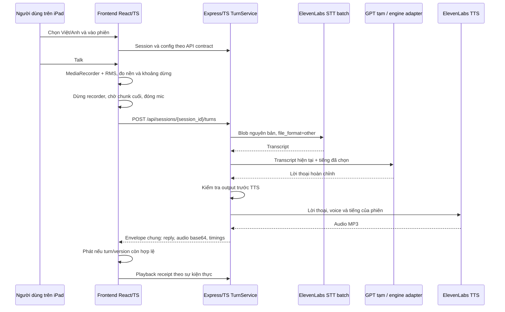

# Kế hoạch triển khai voice pipeline

Cập nhật ngày **31/10/2026** theo [các quyết định đã chốt](decisions.md), gồm yêu cầu dùng Express + TypeScript và logging theo LittleBuddy brain. Trạng thái thực tế ở [implementation-status.md](implementation-status.md), lệnh chạy ở [pipeline README](../../backend/pipeline/README.md), module/dependencies ở [backend-architecture.md](backend-architecture.md). Probe riêng STT → GPT → TTS thật Việt/Anh đã qua trên máy phát triển và server; chưa nghiệm thu iPad hoặc p95. Job tạo bộ audio đầu vào dùng ElevenLabs TTS là đợt riêng.

## 1. Kiến trúc đã chọn

- **Backend:** Express 5 + TypeScript trên Node.js. Routes/controllers xử lý HTTP; TurnService điều phối batch; SessionService và repository RAM giữ protocol state; adapters STT/GPT/TTS nằm riêng. Giữ API keys phía server, cancellation, timeout, chuẩn hóa lỗi, timing và endpoint chung.
- **Frontend:** React + TypeScript, web responsive trên iPad; thành viên frontend phụ trách UI và nối controller audio theo tài liệu bàn giao.
- **Input:** MediaRecorder ghi blob; Web Audio đo RMS với ngưỡng thích nghi; im lặng 1.500 ms sau tín hiệu thì chốt; có Gửi thủ công và Stop/Hủy.
- **STT/GPT/TTS:** ElevenLabs Scribe v2 batch → GPT tạm `gpt-6-luna` stateless → ElevenLabs Flash v2.5. Chọn Việt/Anh trước phiên; mặc định Phan Anh `mgBpvrNosWzExdPuRbXP` cho Việt, Little Dude II `fBD19tfE58bkETeiwUoC` cho Anh, kế thừa bản local little-buddy-impl. [Danh sách voice](voices.md).
- **HTTP:** theo [API contracts](../api-contracts.md), một request turn cho toàn bộ xử lý; browser không gọi ba route provider riêng.



Server orchestrator/session/envelope dùng hợp đồng chung. Voice adapter chỉ cung cấp transcript, lời thoại hoặc audio/timing phù hợp từng stage; không tự tạo memory, cảm xúc, diary hoặc trạng thái quan hệ. Trong lần thử riêng này GPT tạm không dùng history/memory; việc tích hợp engine thật là đổi `ResponseGenerator`, không viết lại STT/TTS.

Trong lúc một request batch đang chờ, frontend hiển thị đang xử lý. Các stage STT/GPT/TTS là trạng thái nội bộ backend; không tạo tiến trình giả bằng timer. Debug panel có thể đọc diagnostics theo API chung nếu cần.

## 2. Phân chia công việc và module đã triển khai

| Phần của bạn | Bàn giao cho người khác |
| --- | --- |
| Backend Express/TS trên Node, STT/TTS adapters, GPT stub, internal interfaces, timing/lỗi/hủy và API integration | Engine thật tiếp nhận transcript và trả lời thoại đã kiểm định |
| Spec/cấu hình RMS, recorder MIME, lifecycle, API types và bài kiểm thử voice | Người làm frontend tích hợp mic/detector/player và responsive layout trên iPad |
| Benchmark voice và phối hợp chỉnh margin/ngưỡng trên thiết bị thật | Frontend sửa layout/touch/portrait/landscape/split view; không giao thiết kế UI sang phần backend |

```text
backend/pipeline/src/
  app.ts                          # lắp dependencies, HTTP middleware và routers
  server.ts / server-runtime.ts   # listen, process signals, dispose và sockets
  config.ts / ports.ts             # env và interfaces nội bộ
  http/                           # auth input, multipart RAM, error mapping
  modules/sessions/               # routes → controller → service → repository RAM
  modules/turns/                  # routes → controller → TurnService, reply policy
  modules/system/                 # health, voices, demo panel
  providers/elevenlabs/            # STT batch và TTS adapters riêng
  providers/openai/                # GPT response generator stateless
  providers/fake.ts                # fixture path không gọi provider
  audio.ts / multipart-limit.ts    # codec/duration và giới hạn wire bytes
  state.ts                        # compatibility exports cho caller cũ
frontend integration contract (người làm frontend thực hiện):
  microphone / recorder     # một stream, MIME thực, flush chunk cuối
  adaptive-silence          # RMS/noise floor/hysteresis/timer
  turn-controller           # request_id, phiên/version, abort + cancel API
  playback                  # async play, receipt, cleanup
```

Code backend ở `backend/pipeline/src`, types chung ở `packages/voice-contracts`, logic browser ở `packages/voice-client`; frontend owner nối library vào UI. Không thêm công việc ở `backend/memory/`. Hợp đồng toàn app có memory/character; các stage đó do người phụ trách tương ứng cung cấp, không được mô tả là tính năng voice đã hoàn thiện.

## 3. Thứ tự triển khai và điều kiện hoàn tất

| Bước | Công việc | Điều kiện đạt |
| --- | --- | --- |
| P0 — Chuẩn bị | Theo API contract; D08 có ID; D10 dùng normal mode theo brain; kiểm tra model, voice và HTTPS trên iPad | Real probe Việt/Anh đã qua với default voice; tier/thời hạn retention cụ thể và thiết bị thật còn cần xác nhận |
| P1 — Backend Express/TS và fake adapters | Routers/controllers tách khỏi services/repository/providers; turn/session lifecycle theo contract; timeout/hủy/idempotency/timing; stub không memory | Fake path chạy không key; lỗi/cancel không sinh audio cũ; HTTP và wire contract giữ nguyên khi tách module |
| P2 — Bàn giao capture iPad | Cùng frontend feature-detect MIME, MediaRecorder + RMS, calibration, Gửi/Stop, permission/audio state | Blob MP4/AAC hoặc WebM theo capability được giữ nguyên; các timer D05 đúng; không auto-upload khi chưa có tín hiệu |
| P3 — STT batch | `file` + `file_format=other`, `language_code=vi|en` theo cấu hình phiên; lỗi/quota/empty text | Đọc được câu Việt/Anh; không auto-switch; không gọi GPT trên transcript rỗng |
| P4 — GPT tạm | Responses API, `gpt-6-luna`, effort none, 200 token, input hiện tại, output checks | Lời thoại ngắn đúng ngôn ngữ phiên; không tools/history/memory; engine adapter thay được |
| P5 — TTS và response | Flash v2.5, approved voice, MP3, envelope base64 theo contract | Đúng `audio.mime_type`, duration và turn/version; frontend phát/receipt theo sự kiện thực |
| P6 — Đo và tối ưu latency | Timing theo stage, kết nối provider tái sử dụng khi hỗ trợ, payload nhỏ, output ngắn | Báo cáo cold/warm và latency đầy đủ, không đổi batch hoặc cắt bớt 1,5 giây đã chọn để đạt số đẹp |
| P7 — Rehearsal iPad và bàn giao | HTTPS thật trên iPad; xoay màn hình/split view, mic denial, play blocked, tab ẩn, mạng lỗi, Stop | Có kết quả thực tế, giới hạn còn lại, config và hướng dẫn cho frontend/engine |

D10 đã cập nhật theo yêu cầu dùng brain: `STT_LOGGING=1` mặc định, bỏ query logging cho STT; TTS không gửi query này. `0` mới yêu cầu STT ZRM và đang bị 403 trên tài khoản hiện tại. Real mode cần hai provider key; không còn yêu cầu chọn cờ logging lại trước khi chạy. P3/P4/P5 đã có probe provider thật Việt/Anh; tiếp tục kiểm thử iPad, chất lượng và benchmark theo checklist, không coi normal mode là zero retention. Không in key từ `.env` vào báo cáo. Chưa có deadline nên không tự gán số ngày hoặc ngày bàn giao.

## 4. Cấu hình đã chốt và kỹ thuật còn tune

| Mục | Giá trị |
| --- | --- |
| Chế độ | Batch, `adaptive_rms`, audio nguyên bản qua backend |
| End silence | 1.500 ms sau khi đã có tín hiệu |
| Initial wait | 5.000 ms sau calibration, không tính lúc xin quyền |
| Max recording | 30.000 ms tính từ recorder bắt đầu, gồm calibration |
| Giới hạn upload | Audio 5 MiB; tổng multipart 6 MiB, thống nhất API/client/server |
| Ngôn ngữ | Chọn `vi` hoặc `en` trước phiên; server config là nguồn quyết định |
| Calibration/margin | 750 ms, 12/6 dB, min signal 120 ms là khởi điểm đề xuất để tune |
| Codec trên iPad | Feature-detect MP4/AAC và WebM/Opus, dùng MIME thực; không ép mọi iPad giống nhau |

Không thêm Audio Isolation/model VAD/transcoding/realtime/streaming trong v1. Nền ồn hoặc giọng nhỏ có thể làm detector sai; ghi nhận ca lỗi và tune thay vì mô tả nó là bộ nhận diện giọng người.

## 5. Ưu tiên latency trong phạm vi batch

Mục tiêu tích hợp theo [pipeline chung](../pipeline.md): p95 âm thanh trả lời đầu tiên **≤5 giây sau kết thúc thu**, đo 30 câu ngắn mỗi ngôn ngữ/provider trên thiết bị/mạng demo thực. Đây là mục tiêu, chưa có số đo. Báo cáo median/p95 thực tế cùng số lỗi và codec/mạng/thiết bị thử.

- Chỉ một upload và một response chứa audio, không round trip qua ba endpoint hoặc thêm isolation.
- Giữ SDK/client server tái sử dụng kết nối khi được hỗ trợ, đo cold/warm để thấy phần khởi tạo.
- Gửi container nhỏ từ MediaRecorder, không chuyển PCM hoặc tải lại audio từ URL phụ; không đánh đổi bằng sai MIME.
- Giữ reply 1–3 câu ngắn, tối đa một câu hỏi; dùng model/voice đã chọn và effort none cho GPT tạm.
- Chỉ chạy TTS sau khi toàn bộ lời thoại đã được kiểm tra. Không phát token chưa duyệt để giảm số latency.
- Đo riêng endpointing, recorder flush, upload, provider từng stage, response/base64 decode và playback. Không dùng timeout kỹ thuật 10/20 giây làm chỉ tiêu chất lượng.

## 6. Bàn giao responsive iPad

Frontend owner thực hiện layout có touch target tối thiểu 48 CSS px, không tràn ngang; Talk/Gửi/Stop/Phát lại luôn tiếp cận được ở portrait, landscape và split view. Đổi orientation/kích thước không được tự mở mic hoặc upload lần hai. Phần voice đã cung cấp state, config, request/response types và event cleanup qua browser library; UI sản phẩm vẫn thuộc frontend owner.

Truy cập từ iPad cần origin HTTPS tin cậy, không dùng URL HTTP IP LAN rồi coi là localhost. Tạo/resume AudioContext từ thao tác Talk; phát audio phải xử lý `play()` bị từ chối và cho nút Phát chủ động. Khi tab ẩn/khóa màn hình/audio bị gián đoạn, hủy lượt và yêu cầu Talk mới. Chi tiết và nguồn ở [microphone-vad.md](microphone-vad.md) và [integration-validation.md](integration-validation.md).
