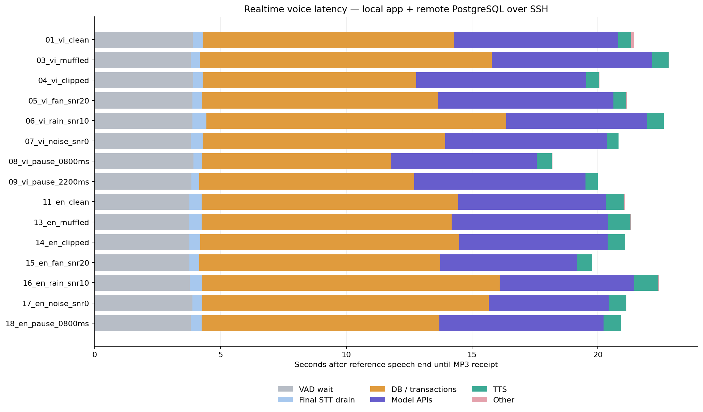

# Đo độ trễ voice realtime

Đo trên app local, engine nhân vật/trí nhớ thật và PostgreSQL từ xa qua SSH tunnel; VAD chờ 3 giây. Mỗi lượt chỉ bàn giao full transcript một lần cho engine, nhưng engine có nhiều API model nội bộ. Dùng schema test riêng; không dùng các hồ sơ production.

Đã thử **20 file**: **15 lượt có MP3**, **4 bị chặn trước engine** và **1 lượt thất bại**. Schema test đã xóa: **True**.

## Thời gian sau lời nói cuối

| Thành phần | Trung vị (giây) | Khoảng min–max (giây) |
| --- | ---: | ---: |
| Chờ VAD sau lời cuối | 3.83 | 3.74–3.92 |
| Flush/chốt transcript cuối | 0.40 | 0.31–0.56 |
| Database và transaction | 9.93 | 7.50–11.91 |
| Các API model (không cộng trùng chạy song song) | 6.22 | 4.78–6.98 |
| TTS adapter, gồm kiểm tra MP3 | 0.64 | 0.45–0.96 |
| Xử lý/transport còn lại | 0.01 | 0.01–0.12 |
| Tổng từ lời cuối đến nhận MP3 | 21.07 | 18.19–22.83 |

Các trung vị theo cột không nhất thiết cộng thành trung vị tổng. Biểu đồ dùng phân rã từng lượt có thể cộng được. Phần chồng lấp model/DB được tính vào “còn lại”; thời gian từng truy vấn trong transaction có thể gồm chờ hàng đợi, nên dùng union của các khoảng thời gian.



## Điểm đang tốn thời gian nhất

- Database/transaction chiếm trung bình **47.5%** đường chờ sau lời cuối; model API chiếm **29.0%**. Đây là phép chia trên tổng/mean thời gian của các lượt hoàn tất, không cộng trung vị.
- Có trung vị **120 SQL/lượt** sau khi chốt transcript. Trong các lượt bình thường, 85 query nằm ở 5 lần reconcile ngoài engine, còn khoảng 35 query ở trong engine.
- `TurnService.execute/check` gọi `SessionService.reconcile`; bridge dùng `context()` để đọc cả memory context. Mỗi snapshot gồm nhiều query và transaction. Database ở xa qua SSH làm chi phí roundtrip lặp lại cộng dồn.
- Engine dùng classify → reply → check với model đã cấu hình; moderation_input chạy cùng classify và moderation_output chạy cùng check. Một dispatch engine không đồng nghĩa một request LLM.
- Trường timings của API có thể gộp cả reconcile DB vào stt/reply/tts. Bảng này đo adapter và transaction riêng để tránh quy toàn bộ số đó cho provider.
- Khởi tạo profile/config trước lượt có trung vị **7.80s**; kết nối stream **1.58s**. Hai khoản này không nằm trong tổng sau lời cuối.

## Thứ tự tối ưu đề xuất

1. Dùng kiểm tra version/state nhẹ ở các fence của TurnService thay cho tải lại toàn context; giữ kiểm tra stale state, hủy và forgetting, không bỏ các fence an toàn.
2. Gom query snapshot hoặc giảm số roundtrip, đo lại cùng điều kiện. Đừng chỉ đổi Promise.all: adapter PostgreSQL hiện serialize query trên cùng transaction/connection.
3. Sau đó mới đánh giá chi phí ba bước model bằng test chất lượng thật. Không tự thay model hoặc bỏ kiểm duyệt chỉ để đạt số latency tốt hơn.
4. Giữ mốc VAD 3 giây đã chọn trong lần đo này. TTS đang nhỏ hơn nhiều so với DB và engine; ưu tiên tối ưu sau.

## Từng API model

| Bước | Số request | Trung vị (giây) | Tối đa (giây) |
| --- | ---: | ---: | ---: |
| classify | 15 | 2.15 | 2.87 |
| moderation_input | 15 | 0.59 | 1.00 |
| reply | 15 | 2.02 | 2.66 |
| moderation_output | 15 | 0.39 | 0.89 |
| check | 15 | 1.77 | 2.29 |

Các bước moderation có thể chạy song song với classify/check. Không cộng tất cả request duration rồi coi đó là latency của engine.

## Từng file

| File | VAD | Drain | DB | Model | TTS | Còn lại | Tổng (giây) | SQL sau chốt |
| --- | ---: | ---: | ---: | ---: | ---: | ---: | ---: | ---: |
| 01_vi_clean | 3.90 | 0.39 | 9.99 | 6.52 | 0.52 | 0.12 | 21.44 | 120 |
| 03_vi_muffled | 3.83 | 0.35 | 11.61 | 6.38 | 0.64 | 0.02 | 22.83 | 120 |
| 04_vi_clipped | 3.91 | 0.39 | 8.49 | 6.75 | 0.52 | 0.01 | 20.06 | 120 |
| 05_vi_fan_snr20 | 3.89 | 0.38 | 9.36 | 6.98 | 0.52 | 0.02 | 21.15 | 120 |
| 06_vi_rain_snr10 | 3.89 | 0.56 | 11.91 | 5.60 | 0.67 | 0.01 | 22.64 | 120 |
| 07_vi_noise_snr0 | 3.83 | 0.46 | 9.64 | 6.43 | 0.45 | 0.01 | 20.83 | 120 |
| 08_vi_pause_0800ms | 3.92 | 0.35 | 7.50 | 5.80 | 0.60 | 0.02 | 18.19 | 117 |
| 09_vi_pause_2200ms | 3.85 | 0.31 | 8.55 | 6.81 | 0.48 | 0.01 | 20.00 | 117 |
| 11_en_clean | 3.76 | 0.49 | 10.19 | 5.88 | 0.71 | 0.04 | 21.07 | 120 |
| 13_en_muffled | 3.74 | 0.51 | 9.93 | 6.22 | 0.88 | 0.02 | 21.31 | 120 |
| 14_en_clipped | 3.77 | 0.43 | 10.30 | 5.89 | 0.68 | 0.01 | 21.07 | 120 |
| 15_en_fan_snr20 | 3.76 | 0.40 | 9.57 | 5.44 | 0.60 | 0.01 | 19.78 | 120 |
| 16_en_rain_snr10 | 3.78 | 0.49 | 11.82 | 5.35 | 0.96 | 0.01 | 22.42 | 120 |
| 17_en_noise_snr0 | 3.89 | 0.39 | 11.38 | 4.78 | 0.67 | 0.01 | 21.13 | 120 |
| 18_en_pause_0800ms | 3.83 | 0.42 | 9.46 | 6.53 | 0.68 | 0.02 | 20.93 | 117 |

## Các lượt không có MP3

| File | Trạng thái | Mã lỗi quan sát | Engine dispatch |
| --- | --- | --- | ---: |
| 02_vi_soft | rejected | unclear_audio | 0 |
| 10_vi_noise_only | rejected | unclear_audio | 0 |
| 12_en_soft | rejected | speech_stream_closed | 0 |
| 19_en_pause_2200ms | failed | speech_stream_failed | 1 |
| 20_en_noise_only | rejected | unclear_audio | 0 |

Đo lại riêng `19_en_pause_2200ms` bằng schema mới: trạng thái **failed**, mã lỗi engine thật **`model_output_rejected`**; schema follow-up đã xóa: **True**. Không thay kết quả lần đầu bằng kết quả follow-up và không tính mẫu lỗi vào thống kê MP3 thành công. [Dữ liệu chẩn đoán](../voice-latency-2026-10-31-followup-19/report.json).

Trong lần này STT đã nhận đủ hai mệnh đề, nhưng engine chặn câu trả lời trước TTS. Transport WebSocket hiện che AppError thành `speech_stream_failed`, nên phải instrument bridge để thấy code gốc.

## Kiểm tra query theo partial

Trace 20 file có **147 partial**, **0 query và 0 transaction trong giai đoạn stream/drain**. Các query lớn được ghi nhận sau full transcript, không theo từng partial.

Đã hoãn thêm một lần đọc context ở startup stream đến bước full transcript. Probe thật sau sửa xác nhận **0 query/transaction từ mở WebSocket đến acknowledgement cuối**, rồi engine/TTS hoàn tất. Kiểm tra state vẫn chạy trước engine; tạo phiên/config và maintenance riêng không thuộc callback partial. [Trace kiểm tra](partial-db-audit.json).

Đây là thay đổi sau lượt benchmark chính. Nó giảm công việc lúc mở stream, không loại bỏ khoảng 120 query sau full trong các số đo phía trên.

## Kiểm tra roundtrip database

20 lần `SELECT 1` trên cùng kết nối đã warm có trung vị **69.1 ms**, min–max **59.3–152.1 ms**. `EXPLAIN ANALYZE SELECT 1` báo server execution **0.013 ms**.

Đây là bằng chứng cho chi phí đường truyền/SSH/protocol trên từng roundtrip, không phải đo execution plan của mọi query thật. 120 query nối tiếp cùng các BEGIN/COMMIT khiến chi phí này cộng dồn. [Dữ liệu ping](db-roundtrip.json).

## Vị trí code liên quan

- [TurnService](../../backend/pipeline/src/modules/turns/turn.service.ts): reconcile trước begin và trong các check sau mỗi bước.
- [SessionService](../../backend/pipeline/src/modules/sessions/session.service.ts): reconcile gọi bridge.context.
- [Engine bridge](../../backend/integration/engine-bridge.ts): context lấy cả MemoryContext.
- [Memory snapshot](../../backend/memory/index.ts): purge/clock và nhiều truy vấn bảng.
- [PostgreSQL adapter](../../backend/memory/database.ts): query trên một transaction được serialize.

## Chạy lại

Các lệnh từ root, provider thật có tính phí:

```powershell
node --env-file=.env --import tsx scripts/measure-voice-latency.ts --real
# Có thể chọn --ids=01_vi_clean,09_vi_pause_2200ms,11_en_clean,19_en_pause_2200ms
python scripts/summarize-voice-latency.py reports/<thu-muc-run>/report.json
```

## Giới hạn cách đo

- Lời cuối lấy từ ranh giới clip nguồn TTS trong manifest, không phải alignment từng từ do người nghe xác nhận.
- PCM được gửi theo thời gian thực, đợi đủ 200 ms trước mỗi chunk. Đuôi được bổ sung bằng chính nền cuối file để đủ thời gian chờ VAD.
- Kết thúc phép đo ở lúc nhận MP3 đầy đủ. Chưa tính thời gian browser decode/autoplay hoặc microphone iPad vật lý.
- Khởi tạo profile/session và kết nối STT được đo riêng; không gộp vào độ trễ sau lời cuối.
- Profile test mới trong schema riêng; không có memory/history của người dùng thật. Dữ liệu là lượt thực đơn trên các ca tổng hợp khác nhau; không dùng để tuyên bố p95/SLA hay dự đoán production cùng máy với database.
- Bản calibration chỉ bắt query ngoài transaction được giữ riêng và không dùng để kết luận phần database.

Dữ liệu gốc: [report.json](report.json). Tổng hợp máy đọc: [summary.json](summary.json).
